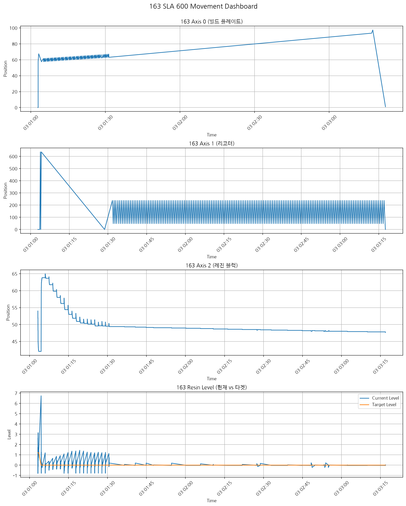

# sla600-log-analyzer

SLA 600 3D 프린터의 raw 공정 로그를 파싱해 빌드 플레이트·리코터·레진 블럭의 시간대별 위치 변화를 한 장의 대시보드로 시각화하는 Python 스크립트입니다.



> 실제 출력 로그 `20250403-010249-163.log`(총 공정 약 2시간 21분, 359 레이어)를 이 스크립트로 시각화한 결과입니다.

## 프로젝트 정보

| 항목 | 내용 |
| --- | --- |
| 기간 | 2025.04.29 ~ 2025.05.13 (2주) |
| 소속 | 한밭대학교 3D프린팅연구실 학부연구생 |
| 형태 | 개인 프로젝트 (로그 해석, 파싱·시각화 코드 작성, 발표까지 단독 수행) |
| 결과 | 발표 (2025.05.13) |

## 문제와 해결

**문제** — SLA 600 장비는 출력이 끝난 뒤 빌드 플레이트·리코터·레진 블럭의 이동 기록을 텍스트 로그로만 남깁니다. 출력 한 건의 로그가 수천~1만 수천 줄에 달해서, 장비가 정상적으로 움직였는지 사람이 읽고 판단하기 어렵습니다.

**참고 사례** — K-DIVA에서는 다른 3D 프린터 장비(M160)의 머신 로그를 산소 농도·압력·온도 같은 시간별 그래프로 보여 줍니다. SLA 600 로그에도 같은 방식을 적용했습니다.

**해결** — 로그에서 축별 위치 값을 추출해 시계열 그래프로 그립니다. 그래프로 보면 다음과 같은 판단을 빠르게 할 수 있습니다.

- **비정상 움직임 포착**: 정상 패턴(예: 서포트 적층 구간의 규칙적인 상하 왕복)에서 벗어나는 구간을 눈으로 바로 찾을 수 있습니다.
- **원인 역추적**: 출력 건마다 그래프가 쌓이면, 이상이 생긴 출력의 패턴을 과거 출력과 비교해 원인을 추적하는 근거로 쓸 수 있습니다.

## 동작 방식

```
로그 파일 → 키워드로 축별 라인 필터링 → 정규식으로 시간·위치 추출 → DataFrame → 그래프
```

입력 로그는 아래와 같은 형식입니다.

```text
[Info] -> 2025-04-03 01:02:50.218  Elevator Go Origin Start
[Info] -> 2025-04-03 01:02:56.951  Axis 0 Move Abs Pos: 57.5 Speed: 5 Current Pos 0
[Info] -> 2025-04-03 01:03:47.704  Axis 1 Move Rel Length: -2000 Speed: 80 Current Pos 636.608
[Info] -> 2025-04-03 01:03:12.661  Before Move Resin current position is 54.000, current level pos is -0.795, target level is 1.200
```

축마다 다음 규칙으로 값을 뽑습니다. `Go Origin`(원점 복귀) 라인은 위치 0으로 기록합니다.

| 그래프 | 필터 키워드 | 추출 값 |
| --- | --- | --- |
| Axis 0 (빌드 플레이트) | `Axis 0`, `Elevator` | `Abs Pos: <값>` |
| Axis 1 (리코터) | `Axis 1`, `Recoater` | `Current Pos <값>` |
| Axis 2 (레진 블럭) | `Before`, `After` | `Resin current position is <값>` |
| Resin Level | `Before`, `After` | `current level pos is <값>`, `target level is <값>` |

코드는 역할별 함수로 나뉘어 있습니다.

- `parse_log()` — 로그 파일을 라인 단위로 읽기
- `extract_series()` — 설정에 따라 시간·값을 추출해 DataFrame으로 변환
- `plot_axis()` — 축 하나의 시계열 그래프
- `plot_dashboard()` — 모든 축을 세로로 쌓은 통합 대시보드

## 빠른 시작

Python 3 환경이 필요합니다. (Python 3.12, pandas 3.0, matplotlib 3.11에서 동작 확인)

```bash
git clone https://github.com/yeekrim/sla600-log-analyzer.git
cd sla600-log-analyzer
pip install -r requirements.txt

python sla_movement_graph.py /path/to/your_log_file.log
```

| 옵션 | 동작 |
| --- | --- |
| (없음) | 통합 대시보드를 화면에 표시 |
| `--individual` | 축별 개별 그래프 4개를 표시 |
| `--save out.png` | 화면 대신 이미지로 저장 (`--individual`과 함께 쓰면 `out_axis0.png`처럼 축별로 저장) |

그래프 제목 앞의 숫자(예: `163`)는 로그 파일명 끝 번호에서 가져옵니다. 한글 라벨은 레포에 포함된 `fonts/NanumGothic-Regular.ttf`로 렌더링하므로 시스템에 한글 폰트가 없어도 됩니다.

## 로그 형식이 다를 때

필터 키워드와 정규식은 스크립트 상단의 `TIMESTAMP`, `AXES` 설정에 모여 있습니다. 로그 형식이 바뀌면 코드 대신 이 설정만 고치면 됩니다.

```python
{
    "key": "axis0",
    "title": "Axis 0 (빌드 플레이트)",
    "filters": ["Axis 0", "Elevator"],          # 하나라도 포함된 라인만 대상
    "values": {
        "position": [                            # 위에서부터 순서대로 시도
            {"when": "Abs Pos", "regex": r"Abs Pos:\s*([-\d\.]+)"},
            {"when": "Go Origin", "const": 0.0},
        ],
    },
}
```

함수를 다른 코드에서 import해서 쓸 수도 있습니다.

```python
from sla_movement_graph import AXES, parse_log, extract_series, plot_dashboard

lines = parse_log("your.log")
datasets = [(extract_series(lines, cfg), cfg) for cfg in AXES]
plot_dashboard(datasets).savefig("dashboard.png")
```

## 그래프 읽는 법

| 그래프 | 볼 수 있는 것 |
| --- | --- |
| Axis 0 (빌드 플레이트) | 적층이 진행될수록 위치값 증가, 서포트 적층 구간에서 상하 왕복 패턴 |
| Axis 1 (리코터) | 기포 제거를 위해 빌드 플레이트 위를 왕복하는 패턴 |
| Axis 2 (레진 블럭) | Before/After 위치 변화로 레진 수위 조절 동작 확인 |
| Resin Level | 현재 레진 레벨과 타겟 레벨의 시간별 격차 |

그래프는 추출된 점을 직선으로 잇기 때문에, 해당 축의 로그가 없는 구간은 직선으로 이어져 보입니다.

## 한계와 향후 계획

현재 한계

- 한 번에 로그 파일 하나만 처리합니다.
- 로그 인코딩은 UTF-8로 고정되어 있습니다.
- 이상 구간을 자동으로 찾지 않습니다. 판단은 그래프를 보는 사람이 합니다.

향후 개선 아이디어

- 정상 패턴 대비 이상 구간 자동 하이라이트 (임계값/규칙 기반 탐지)
- 여러 로그 파일 일괄 처리 및 결과 비교
- 추출한 시계열을 CSV/Parquet로 내보내 데이터 축적

## 발표자료

- [Log Interpretation_SLA600.pptx](Log%20Interpretation_SLA600.pptx) — 출력 시작부터 종료까지 공정 단계별 로그 해석
- [SLA 600 로그 활용 데이터 시각화.pptx](SLA%20600%20%E1%84%85%E1%85%A9%E1%84%80%E1%85%B3%20%E1%84%92%E1%85%AA%E1%86%AF%E1%84%8B%E1%85%AD%E1%86%BC%20%E1%84%83%E1%85%A6%E1%84%8B%E1%85%B5%E1%84%90%E1%85%A5%20%E1%84%89%E1%85%B5%E1%84%80%E1%85%A1%E1%86%A8%E1%84%92%E1%85%AA.pptx) — 프로젝트 배경, 시각화 코드, 실제 로그 시각화 결과 (2025.05.13 발표)

## 라이선스

코드는 [MIT License](LICENSE)를 따릅니다. 번들된 NanumGothic 폰트는 [SIL Open Font License 1.1](fonts/OFL.txt)을 따릅니다.
